  

# 🌟 Awesome Employee Engagement Platforms 

> 🚀 A curated list of leading Enterprise SaaS suites, People Analytics software, and Open-Source Employee Engagement solutions for workforce sentiment analysis, pulse surveys, eNPS measurement, anonymous feedback, and peer recognition.

  
  
  
  
  

---

## 📊 Sector Overview & Market Dynamics

The global employee engagement software market is estimated at **$1.2 billion to $1.4 billion** (scaling to **$3.4 billion to $4.6 billion** when including broader Employee Experience Platforms / EXP suites), growing at a compound annual growth rate (CAGR) of **11% to 17%**. The industry structure is **moderately fragmented**—major enterprise HCM and tech heavyweights (such as Workday, Qualtrics, and Microsoft Viva) collectively hold approximately 25% to 30% of enterprise market share, leaving over 70% of the market distributed among specialized employee experience vendors, mid-market continuous-listening platforms, and niche recognition solutions.

---

## 📑 Table of Contents

- [📊 Sector Overview & Market Dynamics](#-sector-overview--market-dynamics)
- [🏢 SaaS & Hosted Platforms](#-saas--hosted-platforms)
- [💻 Open-Source GitHub Projects](#-open-source-github-projects)
- [🏗️ Key Selection Criteria & Architecture](#️-key-selection-criteria--architecture)
- [📈 Star History](#-star-history)
- [🤝 Support](#-support)
- [💡 How to Contribute](#-how-to-contribute)
- [📜 Disclaimer](#-disclaimer)

---

## 🏢 SaaS & Hosted Platforms

The table below is sorted by **Company Scale (Valuation / Revenue) in descending order**:

| 🏷️ Platform | 💼 Company Scale (Valuation / Revenue) | 💳 Starting Pricing (Specific Entry Tier) | 🎁 Free Tier / Trial Limit | 🚀 Key Highlights & Core Capabilities |
| :--- | :--- | :--- | :--- | :--- |
| [**Glint (Microsoft Viva)**](https://www.microsoft.com/en-us/microsoft-viva) | 🌐 **$3.1T+** Market Cap (Microsoft parent; $245B+ Annual Revenue) | **$2.00 / user / month** (billed annually as standalone Viva Glint add-on) | **30-day free trial** for Microsoft Viva Suite (up to 50 user licenses) | Native Microsoft 365 and Teams integration, real-time sentiment alerts, predictive engagement drivers, and executive heat maps. |
| [**Workday Peakon Employee Voice**](https://www.workday.com/) | 🏛️ **$65B+** Market Cap (WDAY; $9.55B FY26 Revenue) | **$3.50 – $5.00 / user / month** (billed annually for base listening tier; enterprise floor applies) | **Interactive guided demo only**; no self-serve free trial or free tier available | Scalable continuous pulse surveys, multilingual NLP for unstructured feedback comments, and global industry benchmark comparisons. |
| [**Qualtrics EmployeeXM**](https://www.qualtrics.com/) | 💎 **$12.5B** Valuation (Acquired by Silver Lake / CPP; $1.5B+ Annual Revenue) | **$1,500 / month** (~$18,000 / year starting annual contract floor for small teams) | **30-day free trial** of Qualtrics CoreXM (survey builder & sentiment suite; capped at 500 survey responses) | Enterprise-grade listening, multi-channel feedback collection, advanced text analytics via Qualtrics iQ, and predictive attrition insights. |
| [**Workvivo**](https://www.workvivo.com/) | 📹 **$20B+** Zoom Market Cap ($275M acquisition value; $100M+ ARR) | **$20,000 / year** (baseline Business tier for teams up to 250 users; ~$6.67/user/month equivalent) | **Custom sandbox trial** arranged via sales demo (typically 14 to 30 days for evaluated pilot teams) | Digital workplace intranet combining employee social feeds, peer badges/recognition, and micro pulse surveys in one hub. |
| [**Lattice**](https://lattice.com/) | 🦄 **$3.0B** Valuation ($130M+ ARR) | **$13.00 / user / month** (Foundations tier; +$4.00/user/month for Engagement module; $4,000 annual minimum) | **14-day free product tour / interactive sandbox** (no permanent free tier; credit card not required) | Integrated continuous performance, OKR goals, 1:1 agendas, employee engagement surveys, eNPS metrics, and AI synthesis. |
| [**Culture Amp**](https://www.cultureamp.com/) | 🦄 **$1.5B** Valuation ($180M+ ARR) | **$4,500 / year** (Starter plan for teams under 50 employees; scales to $10,500+ for mid-market) | **Interactive product tour only**; no public self-serve free tier or free trial without sales onboarding | Deep people science backing, survey question templates, turnover prediction, demographic sentiment filtering, and executive action plans. |
| [**Leapsome**](https://www.leapsome.com/) | 📈 **$300M** Valuation ($28M+ ARR) | **$8.00 / user / month** (billed annually for Survey module; $199/month minimum account base) | **14-day full feature free trial** (unlimited trial users; no credit card required) | Modular European people enablement platform with pulse surveys, automated survey reminders, continuous feedback, and competency frameworks. |
| [**15Five**](https://www.15five.com/) | 📈 **$250M+** Estimated Valuation ($110M+ ARR; $98M total raised) | **$4.00 / user / month** (billed annually for Engage tier; $5.00/user/month if billed monthly) | **14-day full feature free trial** (up to 25 users with complete survey & check-in capabilities) | Weekly check-in feedback, high-five peer recognition, engagement surveys, OKRs, and manager effectiveness coaching. |
| [**Perceptyx**](https://www.perceptyx.com/) | 🏢 **$200M+** Estimated Valuation ($95M+ Annual Revenue) | **$6.00 / user / month** (billed annually; minimum contract threshold starts at $15,000/year) | **Proof of Concept (PoC) pilot trial** available for qualified enterprise accounts (30-day scope) | Tailored enterprise employee listening architectures, 360 feedback, lifecycle surveys (onboarding/exit), and consulting benchmarks. |
| [**Officevibe (Workleap)**](https://officevibe.com/) | 🏢 **$100M+** Workleap Valuation ($40M+ Annual Revenue) | **$4.00 / user / month** (Pro plan billed annually; or $5.00 billed monthly; Essential tier starts at $3.50) | **Free forever plan** (strictly limited to 1 team and 1 month of historical survey analytics) | Automated weekly pulse check-ins, eNPS tracking, anonymous peer feedback threads, and built-in 1:1 conversation templates. |

---

## 💻 Open-Source GitHub Projects

Open-source employee engagement solutions are ranked below by **GitHub Star Count in descending order**. Each repo includes a direct social badge linked to its stargazers:

### 1. 📋 [Formbricks](https://github.com/formbricks/formbricks)

* 🛠️ **Tech Stack:** TypeScript, Next.js, Tailwind CSS, Prisma, PostgreSQL
* 🎯 **Focus:** Open-source Survey Suite, In-app Pulses & Employee Experience Analytics
* 📝 **Description:** An extensible open-source survey infrastructure and feedback engine. Widely adopted for employee pulse surveys, in-app micro-surveys, anonymous mood tracking, and custom eNPS data collection with complete data ownership and privacy compliance.

### 2. 🏅 [Meeds](https://github.com/Meeds-io/meeds)

* 🛠️ **Tech Stack:** Java, Vue.js, Docker
* 🎯 **Focus:** Employee Recognition, Gamification & Decentralized Engagement Hub
* 📝 **Description:** An open-source employee engagement and recognition platform that drives workforce involvement through peer-to-peer kudos, engagement rewards, contribution badges, and social workplace collaboration tools.

### 3. 🌐 [Nexus](https://github.com/praveen-sripati/nexus)

* 🛠️ **Tech Stack:** React, TypeScript, Tailwind CSS
* 🎯 **Focus:** Modern Intranet, Team Engagement & Organizational Hub
* 📝 **Description:** A modern intranet dashboard and team portal designed to centralize company communications, celebrate team milestones, track workplace engagement initiatives, and share organizational information.

### 4. 🏢 [eXo Platform Core](https://github.com/exoplatform/platform)

* 🛠️ **Tech Stack:** Java, Spring, Vue.js, MySQL
* 🎯 **Focus:** Digital Workplace, Enterprise Social & Peer Recognition
* 📝 **Description:** An enterprise digital workplace engine providing team communication spaces, social networking, recognition badges, and internal employee engagement mechanisms with self-hosted on-premises deployment options.

### 5. 👥 [Microsoft Teams New Employee Onboarding (NEO)](https://github.com/OfficeDev/microsoft-teams-apps-newemployeeonboarding)

* 🛠️ **Tech Stack:** C#, Microsoft Bot Framework, SharePoint
* 🎯 **Focus:** New Hire Engagement & Onboarding Pulse Feedback
* 📝 **Description:** Open-source Teams app built by Microsoft that connects new employees to organizational culture, coordinates peer buddies, and deploys automated onboarding pulse surveys to gauge early retention sentiment.

### 6. ❓ [Employee Survey Questions](https://github.com/joyouslabs/employee-survey-questions)

* 🛠️ **Tech Stack:** Markdown, JSON, Open Question Bank
* 🎯 **Focus:** Open-Source Engagement Question Sets & eNPS Methodology
* 📝 **Description:** A battle-tested open-source question repository formulated by people scientists for measuring workplace sentiment, psychological safety, leadership trust, and employee Net Promoter Score (eNPS).

### 7. 🧭 [OpenSteer](https://github.com/reckonsys/opensteer)

* 🛠️ **Tech Stack:** Python, Django, React
* 🎯 **Focus:** Open Employee Performance, 1:1 Check-ins & Engagement
* 📝 **Description:** An open-source alternative to commercial continuous feedback tools, supporting employee goals, structured 1:1 check-in meetings, and continuous sentiment tracking.

### 8. 🔄 [Check-Ins](https://github.com/objectcomputing/check-ins)

* 🛠️ **Tech Stack:** Micronaut, React, PostgreSQL, GCP
* 🎯 **Focus:** Team Pulse Surveys, Mentorship & Feedback Management
* 📝 **Description:** Full-featured open-source team engagement platform featuring recurring pulse surveys to measure team morale, feedback threads, peer kudos, and mentorship tracking.

### 9. 🙌 [HighFive Employee Recognition App](https://github.com/binduprakash/HighFive-Employee-Recognition-App)

* 🛠️ **Tech Stack:** React, Ruby on Rails, PostgreSQL
* 🎯 **Focus:** Peer Recognition & Gamified Rewards
* 📝 **Description:** A community peer recognition platform facilitating peer-to-peer point allowances, shout-outs tied to company values, rewards redemption, and Slack notifications.

### 10. 📊 [Open Pulse Survey](https://github.com/BrainStation-23/openpulsesurvey)

* 🛠️ **Tech Stack:** Node.js, Express, React, MongoDB
* 🎯 **Focus:** Enterprise Anonymous Pulse Surveys & Real-time Analytics
* 📝 **Description:** Survey management platform engineered for businesses to distribute anonymous employee surveys, track response rates, and generate instant sentiment visualizer dashboards.

### 11. 🤖 [Alignify](https://github.com/iam-tsr/alignify)

* 🛠️ **Tech Stack:** Python, DistilBERT, Qwen LLM, Docker
* 🎯 **Focus:** AI-Powered Anonymous Surveys & NLP Sentiment Classification
* 📝 **Description:** Purpose-built AI employee engagement prototype that uses Qwen for automatic contextual question generation and DistilBERT for real-time sentiment scoring of qualitative employee comments.

### 12. 👍 [Good Job](https://github.com/dongitran/Good-Job)

* 🛠️ **Tech Stack:** NestJS, React, PostgreSQL, SSE
* 🎯 **Focus:** Peer-to-Peer Kudos & Value-Tied Reward System
* 📝 **Description:** Modern recognition platform featuring a dual-balance point distribution system (giveable vs. redeemable), core value tags, real-time activity feeds via Server-Sent Events, and administrative reward inventory tracking.

---

## 🏗️ Key Selection Criteria & Architecture

When architecting or procuring an employee engagement solution, consider the following technical and operational pillars:

1. 🔒 **Strict Anonymity Thresholds:** Platforms must enforce strict group aggregation minimums (typically 3–5 respondents minimum) before presenting filtered demographic reports to preserve individual psychological safety.
2. 🧠 **Qualitative NLP & Sentiment Analysis:** Natural Language Processing capabilities (e.g., DistilBERT, transformer-based LLMs) are essential for categorizing thousands of open-ended survey responses into actionable themes.
3. 🔌 **Integration Ecosystem:** Direct hooks into communication hubs (Slack, Microsoft Teams, Zoom) dramatically elevate survey completion and response rates compared to email-only blasts.
4. 🔄 **Action Planning Loops:** Collecting sentiment without following through damages employee trust; top solutions provide automated manager action templates and follow-up pulses.

---

## 📈 Star History

---

## 🤝 Support

Thank you for visiting and using this curated list! 💖

If you found this resource helpful, please consider:
- ⭐ **Starring** the repository to support discovery
- 🍴 **Forking** and contributing missing tools or updates
- 📢 **Sharing** with your fellow People Operations, HR tech, and engineering peers

You can also support the ongoing maintenance and curation of open developer resources by buying a coffee via the [GitHub Sponsors Dashboard](https://github.com/sponsors/ishandutta2007). ☕

---

## 💡 How to Contribute

We welcome contributions from the community! 🙌

1. Fork this repository.
2. Create a new branch: `git checkout -b feature/add-engagement-tool`.
3. Add your tool to `README.md` following the existing tabular or badge format.
4. Submit a Pull Request with a clear summary of why the platform qualifies.

---

## 📜 Disclaimer

- 📌 This list is community-curated for informational and educational purposes.
- 💰 Product pricing and corporate valuations are subject to market adjustments over time; refer to vendors' official pricing pages for binding quotes.
- 🛡️ Always perform privacy impact assessments (GDPR, CCPA) prior to implementing employee listening tools.

---

  <b>Built with ❤️ for People Operations, People Analytics, HR Tech Engineers &amp; Engineering Leaders.</b>

